# Achievements

Mira Unleashed adds **55 achievements**, shown in their own **Mira Unleashed** tab of the Achievements browser. Progress for multi-step achievements is tracked automatically, and some persist across rounds or even across sessions.

Rarity tiers: **Common** -> **Rare** -> **Epic**.

> One achievement is **hidden**: its name, artwork and requirement stay secret until you unlock it.

## General

| Artwork | Achievement | Requirement | Rarity |
| --- | --- | --- | --- |
| 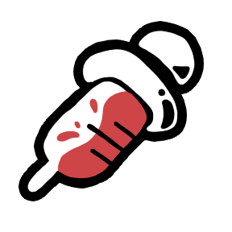 | **Unleashed** | Get assigned a Mira Unleashed role. | Common |
| ❓ | **???** | *Hidden achievement. Unlock it to reveal its details.* | ??? |

## Crewmate

### Forestaller

| Artwork | Achievement | Requirement | Rarity |
| --- | --- | --- | --- |
|  | **Nothing Left to Sabotage** | Complete all tasks as Forestaller and lock evildoers out of the sabotage menu. | Common |
|  | **Speedrun Lockdown** | Activate the Forestaller lock before the first meeting of the game. | Rare |
|  | **Under Pressure** | Complete all tasks as Forestaller while a Hex Bomb countdown is active. | Epic |
|  | **Eleventh Hour** | Activate the Forestaller lock while a critical sabotage is counting down. | Epic |

### Mirage

| Artwork | Achievement | Requirement | Rarity |
| --- | --- | --- | --- |
|  | **Gottem!** | Catch someone interacting with your decoy as Mirage. | Common |
|  | **Carnival of Illusions** | Have your decoys triggered 3 times in a single game. | Rare |
|  | **Mirror Match** | Trigger a decoy on a player who is currently morphed. | Epic |

### Trapper

| Artwork | Achievement | Requirement | Rarity |
| --- | --- | --- | --- |
|  | **The Welcoming Committee** | Snare someone in one of your vent traps as Trapper. | Common |
|  | **Pest Control** | Snare 5 players in your vent traps (persists across sessions). | Rare |
|  | **Red Handed** | Snare 2 players in your vent traps in a single game. | Rare |
|  | **Caught in the Act** | Snare a player who was invisible when they entered your trapped vent. | Epic |
|  | **Caught and Convicted** | Have a player you snared get ejected in the very next meeting. | Rare |

## Impostor

### Charlatan

| Artwork | Achievement | Requirement | Rarity |
| --- | --- | --- | --- |
| 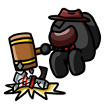 | **Body Double** | Fully conceal a body as Charlatan. | Common |
| 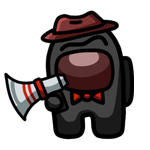 | **Smoke and Mirrors** | Deceive 3 bodies as Charlatan in a single game. | Rare |
|  | **Framed** | Deceive-report a body and have a different player ejected in that meeting. | Epic |

### Hacker

| Artwork | Achievement | Requirement | Rarity |
| --- | --- | --- | --- |
|  | **DDoS Attack** | Jam players 3 times as Hacker in a single game. | Rare |
| 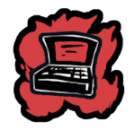 | **Low Ping, High Crime** | Kill a player while your jam is active. | Rare |
|  | **Blackout** | Activate Jam while lights are sabotaged. | Rare |
|  | **Backdoor Access** | Activate Jam while a Forestaller has locked out sabotages. | Epic |

### Injector

| Artwork | Achievement | Requirement | Rarity |
| --- | --- | --- | --- |
| 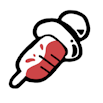 | **Malpractice** | Inject a player as Injector. | Common |
|  | **Double Dose** | Inject the same player twice in one game. | Rare |
|  | **Clinical Trial** | Inject 5 players in a single game. | Rare |
|  | **Triple Threat** | Inject the same player three times in one game. | Epic |
|  | **Bad Medicine** | Inject a player who is under a Witch's spell. | Rare |
|  | **Lab Rat** | Have a player you injected get killed by a teammate before the next meeting. | Rare |

### Witch

| Artwork | Achievement | Requirement | Rarity |
| --- | --- | --- | --- |
| 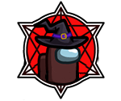 | **Marked for Death** | Place a spell on a player as Witch. | Common |
|  | **Practiced Hand** | Place spells on 10 players as Witch. | Rare |
|  | **Twin Sacrifice** | Kill 2 players with your hexes in a single meeting. | Epic |
|  | **Full Coven** | Have 5 players under your spell at the same time. | Epic |
|  | **Double Hex** | Cast a spell on a player already hexed by a Spellslinger. | Epic |

### Wraith

| Artwork | Achievement | Requirement | Rarity |
| --- | --- | --- | --- |
| 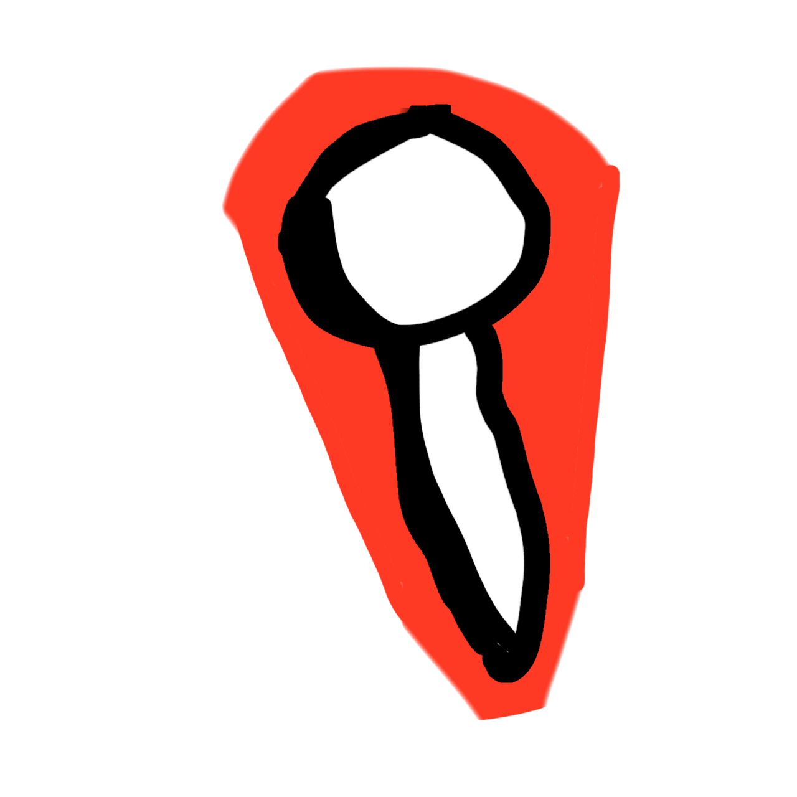 | **Hit the Ground Screaming** | Kill a player while dashing as Wraith. | Rare |
| 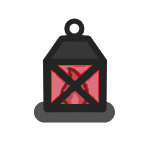 | **Lamplight Lethality** | Kill a player while invisible next to your lantern. | Rare |
|  | **Fade to Black** | Kill 5 players as Wraith (persists across sessions). | Rare |
|  | **Lantern Guided** | Teleport back to your lantern and kill a player within 3 seconds. | Epic |

## Neutral

### Lawyer

| Artwork | Achievement | Requirement | Rarity |
| --- | --- | --- | --- |
|  | **Court Appointed** | Get assigned a client as Lawyer. | Common |
| 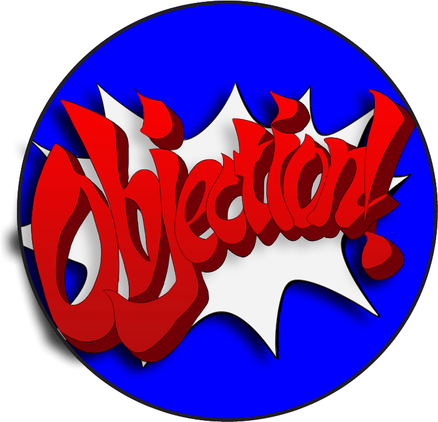 | **Objection Sustained** | Object to the votes while your client has at least one vote on them. | Rare |
|  | **Devil's Advocate** | Win as Lawyer while your client is an Impostor or Neutral Killer. | Epic |

### Scavenger

| Artwork | Achievement | Requirement | Rarity |
| --- | --- | --- | --- |
| 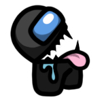 | **Clean Plate Club** | Eat 3 bodies in a single game as Scavenger. | Rare |
| 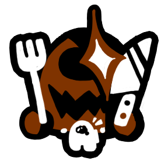 | **Buffet Regular** | Eat 10 bodies as Scavenger (persists across sessions). | Rare |
|  | **Bottomless Pit** | Eat 3 bodies in a single round as Scavenger. | Epic |
|  | **Fast Food** | Eat a body within 10 seconds of the kill. | Rare |

### Serial Killer

| Artwork | Achievement | Requirement | Rarity |
| --- | --- | --- | --- |
| 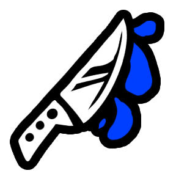 | **Cold Open** | Claim the first kill of the game as Serial Killer. | Common |
|  | **Serial Season** | Kill 10 players as Serial Killer (persists across sessions). | Rare |
|  | **Massacre** | Kill 3 players as Serial Killer in a single round. | Epic |
|  | **Snake in the Pipes** | Kill a player inside a vent as Serial Killer. | Rare |

## Modifiers

### Spiteful

| Artwork | Achievement | Requirement | Rarity |
| --- | --- | --- | --- |
| 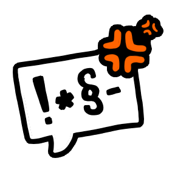 | **Pyrrhic Vote** | Get cursed after voting for a Spiteful player. | Common |
|  | **Misery Loves Company** | Get ejected as a Spiteful player and curse 2 or more voters. | Rare |
|  | **Parting Gift** | Get ejected as a Spiteful player and curse everyone who voted for you. | Epic |

### Clueless

| Artwork | Achievement | Requirement | Rarity |
| --- | --- | --- | --- |
| 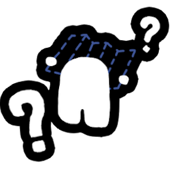 | **Wing It** | Complete a task as a Clueless player. | Common |
|  | **Muscle Memory** | Complete 5 tasks as a Clueless player in a single game. | Common |
|  | **Clueless Completionist** | Complete all tasks as a Clueless player in a single game. | Epic |
|  | **Burn the Witch** | While under a Witch's spell, vote out the Witch and live to tell about it. | Rare |
|  | **Blind Justice** | Vote out an Impostor or Neutral Killer while Clueless. | Rare |

